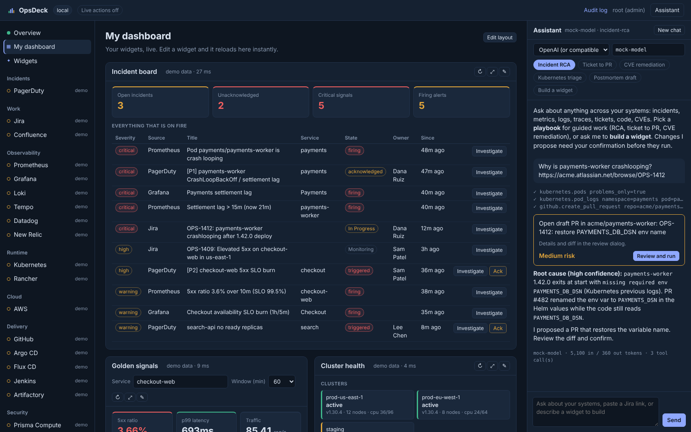
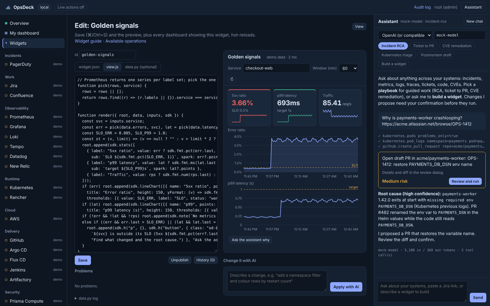

# OpsDeck

An AI-agent SRE platform: one console where SRE engineers run incidents, read metrics, logs and traces, manage Kubernetes across clusters, chase CVEs, and turn tickets into pull requests, with an AI agent that works across all of it and widgets you can build by describing them.



- **AI agent on any LLM.** Claude (API or Bedrock), OpenAI or any OpenAI-compatible gateway (Azure OpenAI, vLLM, LiteLLM, OpenRouter), Gemini, or Ollama for air-gapped use. Users pick the provider and model per conversation. The agent calls every integration as a tool, streams its investigation step by step, and can only *propose* changes.
- **Playbooks** steer it for common work: Incident RCA, Ticket to PR, CVE remediation, Kubernetes triage, Postmortem draft, Build a widget. Teams add their own as Markdown files; edits apply immediately.
- **Widgets you build by asking.** Describe a widget ("p99 latency and 5xx for checkout-web with the firing alerts below"); the AI samples the real data, writes it, validates it, fixes its own errors and saves a draft. Edit the code in the browser or on disk and it **hot-reloads in every open browser, with no restart**. Widgets run in a sandboxed iframe and can only call the operations they declare.
- **21 integrations** with demo data for each, so everything works with zero credentials:

  | Area | Integrations |
  |---|---|
  | Incidents & work | PagerDuty, Jira (paste a ticket URL), Confluence (incl. publishing postmortems) |
  | Observability | Prometheus / Mimir / Thanos + Alertmanager, Grafana, Loki, Tempo, Datadog (monitors, metrics, logs, APM), New Relic (NRQL, APM, issues) |
  | Runtime | Kubernetes, Rancher (every managed cluster), AWS |
  | Delivery | GitHub / GitHub Enterprise (code search, files, commits, PRs, Actions, compare, **open PRs**), Argo CD, Flux, Jenkins, Artifactory |
  | Security | Prisma Cloud Compute (image CVEs), Prisma Cloud CSPM, CVE intel (NVD, FIRST EPSS, CISA KEV, OSV) |
  | AI | HolmesGPT (optional: delegate a question to a running HolmesGPT server) |

- **Gated actions:** rollout restart, scale, Rancher restart, Argo CD sync, Flux reconcile, Jenkins build, PagerDuty ack/resolve/note, Jira comment, Confluence page, GitHub pull request. Each needs an explicit confirmation (PRs show the full diff), is signed to your identity, single-use, role-checked and audited.

How it compares with existing open-source projects, and the design behind it: [docs/ARCHITECTURE.md](docs/ARCHITECTURE.md). Widget authoring: [docs/WIDGETS.md](docs/WIDGETS.md).

### What the SRE workflows look like

| You do | OpsDeck does |
|---|---|
| Paste `https://acme.atlassian.net/browse/OPS-1412` with the **Ticket to PR** playbook | Reads the ticket, searches GitHub for the config key or error, reads the files, explains the change, and proposes a draft PR. You review the diff and confirm. |
| "Why is payments-worker crashlooping?" with **Incident RCA** | Checks alerts, golden signals, pod status, previous-container logs, traces, and what changed (Argo/Flux, commits, Grafana deploy annotations), then answers with a timeline, root cause with evidence and confidence, and a proposed mitigation. |
| Click **Restart** on a degraded workload | Rancher or Kubernetes rolling restart after confirmation, within the RBAC you granted. |
| **CVE remediation** on a Prisma finding | Enriches the CVE with KEV, EPSS, CVSS and OSV fixed versions, finds where the package or base image is declared (Dockerfile, manifest, Terraform), and proposes the upgrade PR. |
| "Build a widget that shows..." | A new widget appears under Widgets, live, as a draft. |

---

## 1. Run it on your Mac

You need Python 3.11+ (`brew install python@3.12`) or Docker Desktop.

### Option A: Python (recommended for real use)

```bash
unzip opsdeck.zip && cd opsdeck
python3 -m venv .venv && source .venv/bin/activate
pip install -e ".[dev]"
cp .env.example .env
opsdeck                     # serves http://127.0.0.1:8080
```

Open http://127.0.0.1:8080. Everything runs on demo data until you add credentials.

### Option B: Docker

```bash
cp .env.example .env
docker compose up --build   # http://localhost:8080
```

The container mounts `~/.kube` and `~/.aws` read-only. Two cases need Option A instead:

- **EKS kubeconfigs** call the `aws` CLI to get tokens, and the image doesn't include it.
- **Local clusters** (kind/minikube) often have kubeconfigs pointing at `127.0.0.1`, which isn't reachable from inside the container.

### Connect real systems

Edit `.env` one system at a time and restart `opsdeck`. A system flips from **demo** to **live** in the left nav once its variables are set. The Overview's Connections grid shows whether it connected and the latency.

| System | Minimum settings | Credential to use |
|---|---|---|
| Kubernetes + Flux | `K8S_ENABLED=true`, optional `K8S_CONTEXT`, `K8S_NAMESPACES` | Your kubeconfig |
| Argo CD | `ARGOCD_URL`, `ARGOCD_TOKEN` | `argocd account generate-token --account opsdeck` (read-only RBAC) |
| Jenkins | `JENKINS_URL`, `JENKINS_USER`, `JENKINS_TOKEN` | User API token |
| Artifactory | `ARTIFACTORY_URL` (ends in `/artifactory`), `ARTIFACTORY_TOKEN` | Read-only access token |
| AWS | `AWS_REGIONS=us-east-1`, optional `AWS_PROFILE` | Standard AWS chain (SSO profile, keys, instance role) |
| Prisma Cloud | `PRISMA_URL`, `PRISMA_ACCESS_KEY`, `PRISMA_SECRET_KEY` | Access key on a read-only role |
| Jira | `JIRA_URL`, `JIRA_TOKEN`, plus `JIRA_USER` on Cloud | Cloud API token, or Data Center PAT with no user |
| Confluence | `CONFLUENCE_URL`, `CONFLUENCE_TOKEN`, plus `CONFLUENCE_USER` on Cloud | Same as Jira |
| Assistant | `ANTHROPIC_API_KEY`, or `OPSDECK_LLM_PROVIDER=bedrock` + `BEDROCK_MODEL_ID` | |

Behind a corporate TLS-inspecting proxy (Zscaler and similar), set `OPSDECK_CA_BUNDLE=/path/to/corp-ca.pem`.

Actions against **live** systems are blocked until you set `OPSDECK_ENABLE_WRITES=true`. Actions against demo integrations always work, so you can try the confirmation flow.

---

## 2. Run it on an EC2 instance running Kubernetes

These steps assume **k3s** on the instance, which is the most common single-node setup. Notes for EKS and kubeadm follow at the end.

### 2.1 Quickest: run it on the host, reach it over SSH

No image or chart needed. It reads the cluster through k3s's kubeconfig.

```bash
# on the EC2 instance
sudo dnf install -y python3.11 python3.11-pip unzip    # Amazon Linux 2023; use apt on Ubuntu
unzip opsdeck.zip && cd opsdeck
python3.11 -m venv .venv && . .venv/bin/activate && pip install -e .
cp .env.example .env
sudo cp /etc/rancher/k3s/k3s.yaml ~/.kube/config && sudo chown $USER ~/.kube/config
sed -i "s/^K8S_ENABLED=.*/K8S_ENABLED=true/" .env
opsdeck                                     # listens on 127.0.0.1:8080 only

# on your Mac
ssh -L 8080:127.0.0.1:8080 ec2-user@<ec2-host>
open http://localhost:8080
```

### 2.2 Proper: deploy into the cluster with Helm

**1. Install Helm on the instance:**

```bash
curl -fsSL https://raw.githubusercontent.com/helm/helm/main/scripts/get-helm-3 | bash
export KUBECONFIG=/etc/rancher/k3s/k3s.yaml   # or ~/.kube/config as above
```

**2. Build the image and make it available to the cluster.** Pick one:

```bash
# (a) No registry: build with Docker, import into k3s's containerd
sudo dnf install -y docker && sudo systemctl start docker
sudo docker build -t opsdeck:0.1.0 .
sudo docker save opsdeck:0.1.0 | sudo k3s ctr images import -

# (b) ECR, which works for multi-node clusters and EKS too
aws ecr create-repository --repository-name opsdeck
aws ecr get-login-password | docker login --username AWS --password-stdin <acct>.dkr.ecr.<region>.amazonaws.com
docker build -t <acct>.dkr.ecr.<region>.amazonaws.com/opsdeck:0.1.0 .
docker push <acct>.dkr.ecr.<region>.amazonaws.com/opsdeck:0.1.0
```

**3. Create the secrets.** Put tokens in a file that never goes to git. Same keys as `.env`, secrets only:

```bash
cat > prod.env <<'EOF'
ANTHROPIC_API_KEY=...
ARGOCD_TOKEN=...
JENKINS_USER=...
JENKINS_TOKEN=...
OPSDECK_SECRET=<output of: openssl rand -hex 32>
EOF
kubectl create namespace opsdeck
kubectl -n opsdeck create secret generic opsdeck-secrets --from-env-file=prod.env
```

**4. Install.** Non-secret settings go in a values file:

```yaml
# my-values.yaml
image: { repository: opsdeck, tag: "0.1.0", pullPolicy: Never }   # (b): your ECR repo, IfNotPresent
config:
  OPSDECK_ENV_NAME: prod
  AWS_REGIONS: us-east-1
  ARGOCD_URL: https://argocd-server.argocd.svc.cluster.local   # self-signed by default: see note below
  JENKINS_URL: https://jenkins.acme.internal
kubernetes:
  namespaces: [payments, checkout, flux-system]   # empty = whole cluster (ClusterRole)
  allowWrites: false                              # true lets restart/scale/reconcile work
```

```bash
helm install opsdeck deploy/helm/opsdeck -n opsdeck -f my-values.yaml
```

Argo CD's in-cluster endpoint uses a self-signed certificate by default. Either mount its CA with `extraVolumes`/`extraVolumeMounts` and set `config.OPSDECK_CA_BUNDLE`, or, if `argocd-server` runs with `--insecure`, use `http://argocd-server.argocd.svc.cluster.local`.

**5. Open it.** With auth off (the default), use a port-forward over SSH only:

```bash
kubectl -n opsdeck port-forward svc/opsdeck 8080:80     # on the instance
ssh -L 8080:127.0.0.1:8080 ec2-user@<ec2-host>          # on your Mac
open http://localhost:8080
```

**6. AWS access from the pod.** Attach an instance profile with `deploy/aws/opsdeck-readonly-policy.json`. Pods reach the instance metadata service only if the IMDSv2 hop limit is 2:

```bash
aws ec2 modify-instance-metadata-options --instance-id <id> --http-put-response-hop-limit 2 --http-tokens required
```

**7. Shared team access (SSO).** Enable the oauth2-proxy sidecar and an ingress. k3s ships Traefik:

```yaml
oauth2Proxy:
  enabled: true
  provider: oidc
  oidcIssuerUrl: https://<your-okta-or-entra-issuer>
  emailDomains: ["acme.com"]
  extraArgs: ["--redirect-url=https://opsdeck.acme.com/oauth2/callback"]
roles:
  admins: "you@acme.com"
  operators: "sre1@acme.com,sre2@acme.com"   # everyone else is a viewer
ingress: { enabled: true, className: traefik, host: opsdeck.acme.com, tlsSecret: opsdeck-tls }
persistence: { enabled: true }               # keep the audit log across restarts
```

```bash
kubectl -n opsdeck create secret generic opsdeck-oauth2 \
  --from-literal=client-id=... --from-literal=client-secret=... \
  --from-literal=cookie-secret=$(openssl rand -base64 32 | head -c 32)
helm upgrade opsdeck deploy/helm/opsdeck -n opsdeck -f my-values.yaml
```

With oauth2-proxy on, the app binds to `127.0.0.1` inside the pod. Identity headers can therefore only come from the proxy, and nobody can forge them from the network.

**EKS or kubeadm instead of k3s:** use option (b) for the image. On EKS, use IRSA or Pod Identity for AWS (`serviceAccount.annotations: {eks.amazonaws.com/role-arn: ...}`) instead of the instance profile, and an ALB or nginx ingress class.

---

## 3. Roles, safety and audit

| Role | Can |
|---|---|
| viewer | See everything, use the assistant (read-only tools), use widgets, arrange their own dashboard |
| operator | + low/medium-risk actions (restart, Argo sync, Flux reconcile, Jenkins build, PagerDuty ack/note, Jira comment, Confluence page, GitHub PR) + create, edit and publish widgets |
| admin | + high-risk actions (scale), approve widget Python, delete widgets |

- **Local mode** (laptop, or a port-forward with auth off): you are admin. **Proxy mode:** roles come from `OPSDECK_ADMINS` / `OPSDECK_OPERATORS` by email.
- **Every action takes two steps.** *Prepare* returns an HMAC-signed token bound to the user, action and exact parameters. It expires in 5 minutes and can be used once. *Execute* re-checks permissions before running.
- **The AI can only prepare.** It never sees a confirm button and cannot execute anything. Widgets can only prepare actions they declared, and the user still confirms.
- **Live writes have three independent switches:** `OPSDECK_ENABLE_WRITES`, `kubernetes.allowWrites` in cluster RBAC, and the permissions you grant each tool's token.
- **Widgets are sandboxed.** `view.js` runs in an iframe with `sandbox="allow-scripts"` (opaque origin: no cookies, storage or parent DOM) and a CSP with `connect-src 'none'`. It reaches data only through the parent, which allows just the operations in the widget's manifest; the server enforces the same list. A frame that navigates itself is cut off. `data.py` runs on the server only after an admin approves its exact SHA-256; any edit revokes the approval. A lint blocks imports outside an allowlist, dunder access, `exec`/`eval`/`open`. Treat approval like a code review: the lint is not a sandbox.
- **Audit records** (actions, widget saves, approvals, deletions) go to SQLite at `$OPSDECK_DATA_DIR/audit.db` (shown under *Audit log*) and to stdout as JSON for Loki or CloudWatch.
- **Browser protections:** a strict CSP, no `innerHTML` with upstream data, and a required `X-OpsDeck` header on every state-changing call to block CSRF.
- **Prompt injection:** tool output is labelled untrusted in the system prompt, and the design does not rely on the model behaving: it cannot execute changes, and every proposal shows the exact parameters (and diff) to a human.

---

## 4. Widgets



- **Widgets** page: gallery of built-in and team widgets, plus a box to describe a new one. **My dashboard**: each user's own layout (add, remove, reorder, resize).
- **Editor:** `widget.json`, `view.js` and optional `data.py` side by side with a live preview, problems list (validation, Python lint, runtime errors from the frame), "Fix with AI", "Change it with AI", version history with one-click rollback, publish/unpublish and Python approval.
- **Hot reload:** a file watcher on `$OPSDECK_DATA_DIR/widgets` (and the built-ins) reloads a widget the moment any file changes, whether from the editor, the AI, `git pull` or `vim`, and pushes a server-sent event; every open browser re-renders just that widget.
- **Built-ins** to learn from: *Incident board* (PagerDuty + Prometheus + Grafana + Jira merged by a `data.py`), *Golden signals* (PromQL with inputs and SLO thresholds), *Cluster health* (Rancher clusters, restart, pod logs on click), *CVE hotlist* (Prisma findings enriched with KEV/EPSS per CVE, "Find in code", "Remediate").
- Full contract and SDK reference: [docs/WIDGETS.md](docs/WIDGETS.md).

To manage team widgets in git, mount a repository checkout at `$OPSDECK_DATA_DIR/widgets` (e.g. with a git-sync sidecar); merged changes hot-reload.

## 5. Add an integration

An integration is one Python file. It declares its operations; the integration page, the AI's tools and the widget catalog are all generated from those declarations.

```python
# opsdeck/integrations/statuspage.py
from ..config import env
from ..registry import Column, Integration, Param, Section, read_op
from ._common import ago, check, http_client


class Statuspage(Integration):
    name, title, category = "statuspage", "Statuspage", "Incidents"
    description = "Public status page incidents."
    required_env = ("STATUSPAGE_TOKEN", "STATUSPAGE_PAGE_ID")

    @read_op("Unresolved incidents.", (Param("limit", "integer", default=20),))
    def incidents(self, limit=20):
        with http_client(self.settings, "https://api.statuspage.io/v1",
                         headers={"Authorization": f"OAuth {env('STATUSPAGE_TOKEN')}"}) as c:
            data = check(c.get(f"/pages/{env('STATUSPAGE_PAGE_ID')}/incidents/unresolved")).json()
        return [{"name": i["name"], "status": i["status"], "impact": i["impact"], "created": i["created_at"]}
                for i in data[:limit]]

    def demo_incidents(self, limit=20):  # sample data so it works without credentials
        return [{"name": "Degraded checkout", "status": "investigating", "impact": "major", "created": ago(minutes=20)}]

    def widget(self):
        return [Section("Unresolved", "incidents", columns=[Column("name"), Column("status", fmt="status"),
                                                           Column("impact", fmt="status"), Column("created", fmt="time")])]
```

Add it to `ALL_INTEGRATIONS` in `opsdeck/integrations/__init__.py`. Actions use `@action(..., risk="low"|"medium"|"high")` and get the confirmation, role and audit flow automatically. Params support `string`, `integer`, `number`, `boolean`, `array` and `object`. Run `make dev` to restart the server on Python changes.

## 6. Project layout

```
opsdeck/
  main.py              FastAPI app: REST, SSE (chat stream, widget events), widget frames, static UI
  llm.py               Providers: Anthropic, Bedrock, OpenAI(-compatible, Azure), Gemini, Ollama
  assistant.py         Agent loop: tools from the registry, streaming events, proposals only
  playbooks.py         Markdown playbooks (built-in + $OPSDECK_DATA_DIR/playbooks)
  registry.py          Integration base class, @read_op/@action, catalog
  actions.py           prepare -> confirm -> execute, signed single-use tokens
  auth.py, audit.py    identity and roles; SQLite + JSON audit trail
  integrations/        21 integrations, each with demo data
  widgets/             service (store, hot reload, data, approvals, history, dashboards),
                       builder (AI), checks (validation, Python lint), frame + sdk.js/sdk.css, guide.md
  widgets_builtin/     incident-board, golden-signals, cluster-health, cve-hotlist
  static/              index.html, core.js, app.js, widgets.js, app.css (no build step)
deploy/helm/opsdeck    Helm chart (RBAC, optional oauth2-proxy sidecar, ingress, PVC)
tests/                 API, actions, auth, providers, agent loop, widgets, builder, GitHub PRs, live HTTP paths (mocked)
```

Run the tests with `make test`, or `pytest -q`.

## 7. Known gaps and next steps

- **Verified against mocks, not your systems.** Every integration's live path is written against the vendor's documented API; most are exercised only against mocked responses. Expect field-name fixes on first contact (New Relic `aiIssues`, Prisma Compute and HolmesGPT payloads are the most likely).
- **Streaming is per step**, not per token: the UI shows each tool call and each model message as it happens.
- **Single Kubernetes context** for the native Kubernetes integration; use Rancher for multi-cluster.
- **Chat history** lives in the browser tab; there is no shared incident timeline yet.
- **SQLite** for audit with one replica; for HA, swap `audit.py` for Postgres and put widgets on shared storage or git.
- **Next:** GitLab and Bitbucket, ServiceNow change records, Slack/Teams incident channel bot, scheduled agent runs (e.g. investigate every new P1 automatically), per-integration RBAC, shared chat sessions.
